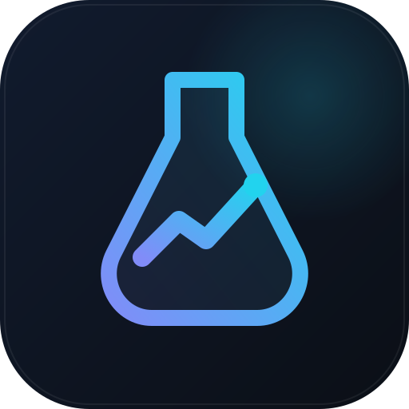
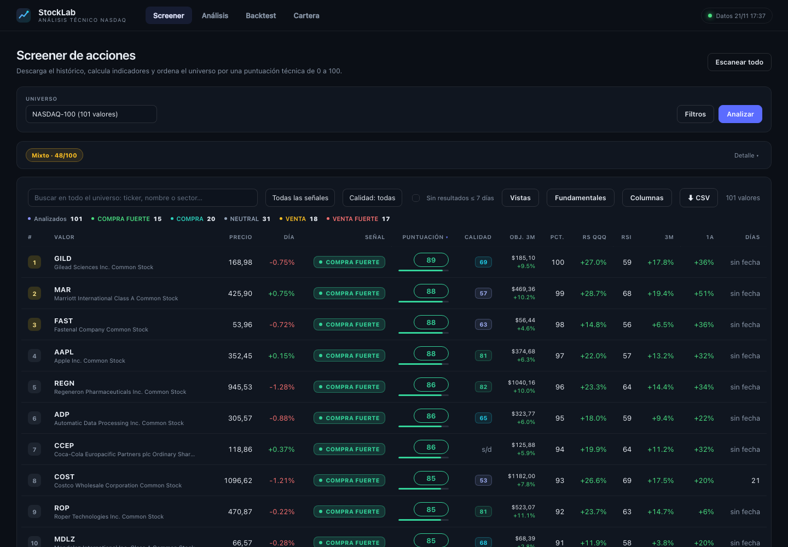
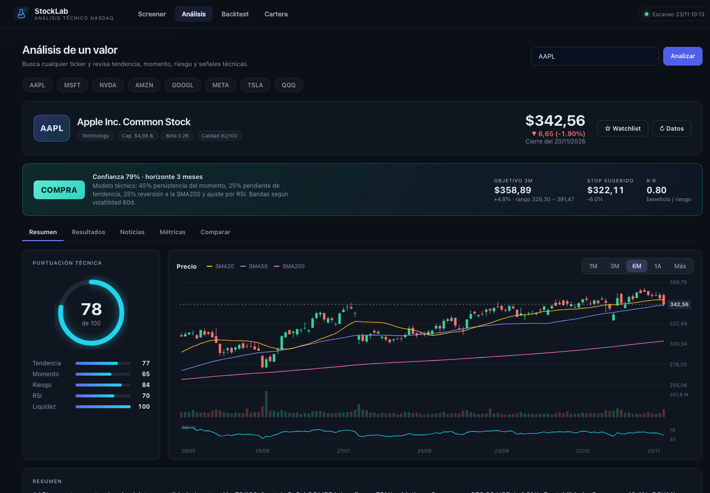
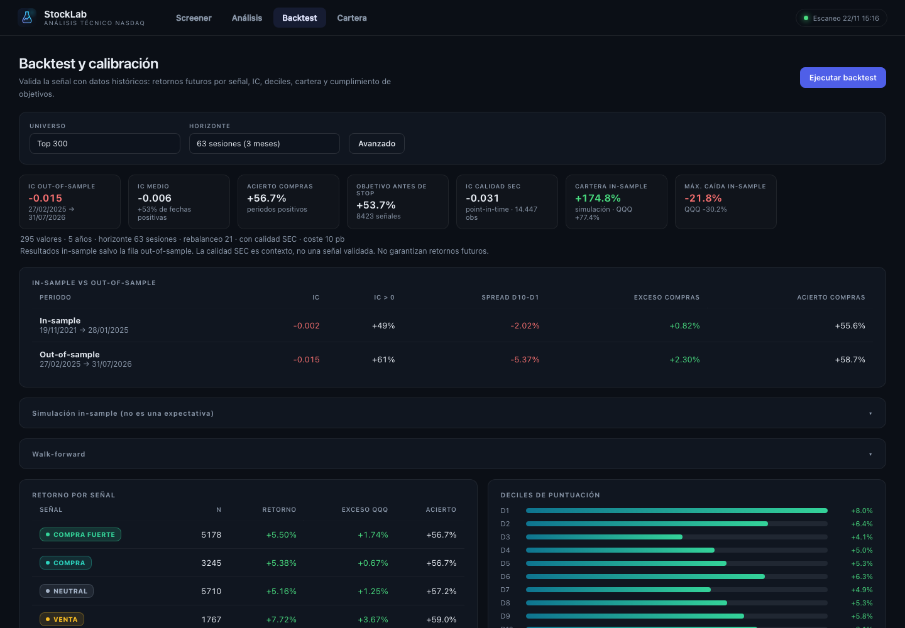
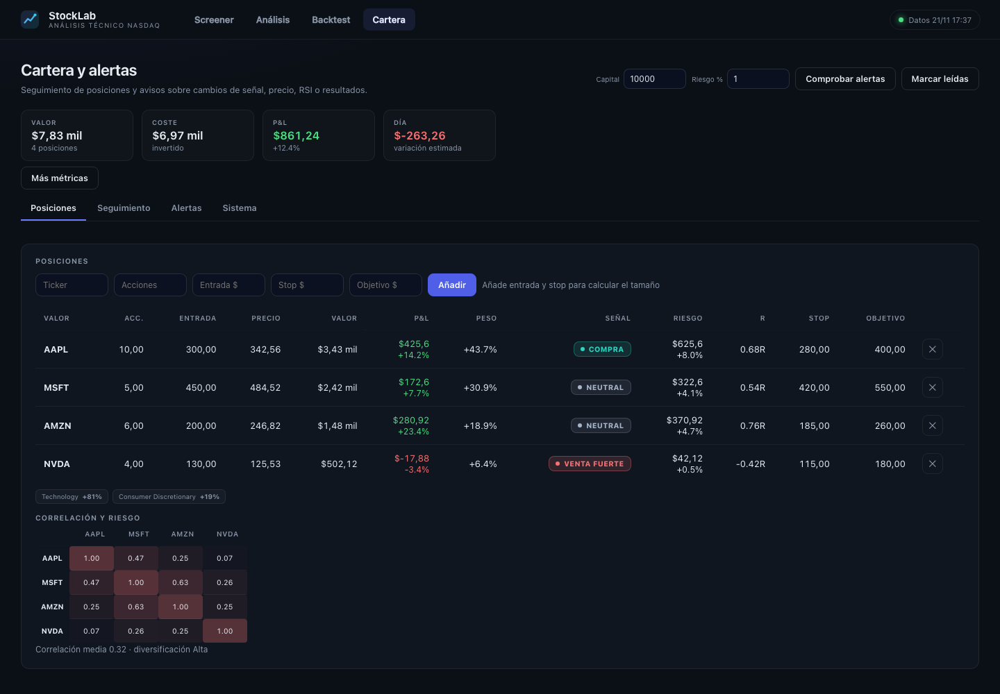

<p align="center">
  
</p>

<h1 align="center">StockLab · Analizador NASDAQ</h1>

<p align="center">
Dashboard local para analizar acciones del NASDAQ: descarga precios diarios, calcula
indicadores técnicos, puntúa cada valor de 0 a 100 y permite comparar todo el índice
o estudiar un ticker concreto.
</p>

<p align="center">
  <a href="https://github.com/ManuelGCh/stocklab-nasdaq/actions/workflows/ci.yml"></a>
  
  
</p>

Sin dependencias externas: solo **Python 3.10+** (probado en 3.14) y la biblioteca estándar.
Los datos se guardan en una base SQLite local, así que las siguientes ejecuciones son
instantáneas.

```bash
git clone https://github.com/ManuelGCh/stocklab-nasdaq.git
cd stocklab-nasdaq
python3 run.py
```

Se abre en `http://127.0.0.1:8765` (si el puerto está ocupado, elige el siguiente libre
y lo imprime). También puedes usar el doble clic en `StockLab.command`.

## Capturas

Datos de demostración (`python3 scripts/seed_demo.py`).









## Demo rápida

```bash
python3 scripts/seed_demo.py    # 4 posiciones y 3 alertas ficticias
python3 scripts/seed_demo.py --clear
```

---

## Fuentes de datos

- **Nasdaq.com**: precios diarios, fundamentales, calendario y consenso.
- **Yahoo Finance**: respaldo de precios históricos.
- **SEC EDGAR**: calidad *point-in-time* desde XBRL.
- **Google News RSS**: titulares y eventos.

Salvo SEC, son endpoints públicos **no oficiales y sin SLA**. Los datos se cachean en
SQLite y no se redistribuyen. La app muestra la lista completa en
**Cartera → Sistema → Fuentes de datos** y en el pie.

Detalle: [`docs/DATA_SOURCES.md`](docs/DATA_SOURCES.md).

### Uso y condiciones

- Proyecto educativo y de investigación personal. **No es asesoramiento financiero**
  ni una recomendación de compra o venta.
- Nasdaq y Yahoo se consultan mediante endpoints **no oficiales**. El uso debe ser
  personal y moderado; revisa sus condiciones antes de automatizar o redistribuir.
- **No se redistribuyen datos de mercado**: la base SQLite se genera en local y queda
  fuera del repositorio. La licencia MIT cubre el código, no los datos de terceros.
- SEC EDGAR exige identificarse. Define `STOCKLAB_SEC_UA` con un contacto real si vas
  a consultarlo de forma intensiva; el valor por defecto es solo un marcador y la app
  avisa por consola cuando falta.

## Validación

El backtest se publica con resultado negativo incluido: a 63 sesiones el IC
out-of-sample es −0,015 y la calidad SEC −0,031. La conclusión es que **no hay evidencia
suficiente de edge**; por eso la calidad es contexto y no señal.

Metodología, muestras y limitaciones: [`docs/VALIDATION.md`](docs/VALIDATION.md).

## Seguridad y alcance

Es una aplicación **local y monousuario**, sin autenticación. No debe exponerse a
Internet. No hay telemetría. Antes de compartirla, revisa
[`SECURITY.md`](SECURITY.md) y la checklist de QA: [`docs/QA_CHECKLIST.md`](docs/QA_CHECKLIST.md).

---

## Qué incluye

**Screener**
- Universo NASDAQ-100 (101 valores) o NASDAQ Composite completo (~6.900; ~5.000 con precio ≥ 1 $).
- Botón **Escanear todo el NASDAQ** con progreso, ETA, cancelación y reanudación por caché.
- Filtros por precio, capitalización, señal y exclusión de fondos/SPACs.
- Tabla ordenable con señal de compra/venta, puntuación, objetivo a 3 meses, RSI,
  retornos, volatilidad y drawdown.
- Columnas y filtros de **calidad, crecimiento, sorpresa de EPS y días hasta resultados**,
  con enriquecimiento por lotes del top 100/300/500.
- Vista compacta por defecto con **herramientas** para columnas, vistas y fundamentales.
- Paginación de 100 filas, selección múltiple y acciones masivas: watchlist, comparador y CSV.
- Exportación a CSV de todos los resultados o solo de la selección (delimitador `;`, decimales con coma).

**Análisis individual**
- Buscador con autocompletado sobre el catálogo local.
- Gráfico de velas con SMA20/50/200, volumen y RSI (canvas propio, sin librerías).
  La ficha descarga hasta ~10 años (máximo disponible en la fuente) para el rango 10A.
- Señal destacada (COMPRA FUERTE … VENTA FUERTE) con confianza, precio objetivo a
  3 meses, stop sugerido, R:R, soporte y resistencia.
- **Resultados y calidad**: cuentas trimestrales, márgenes, FCF, EPS vs consenso,
  próximo reporte, rating y objetivo de analistas, y un score de calidad 0-100.
- Puntuación con desglose, resumen automático y señales técnicas.
- Métricas: RSI, MACD, ATR, volatilidad, drawdown, beta vs QQQ, Sharpe, retornos
  (1M/3M/6M/1A/YTD), rango de 52 semanas y liquidez.

**Watchlist**
- Estrella en cualquier tabla o ficha; se guarda en SQLite, no en el navegador.
- Tarjetas en móvil y análisis conjunto con el mismo motor del screener.

**Fortaleza relativa y régimen**
- Percentil de cada valor dentro del universo (puntuación, momento, tendencia).
- Fuerza relativa frente a QQQ y frente a su sector.
- Panel de régimen: % sobre SMA200, amplitud, mediana de retornos, máximos/mínimos
  de 52 semanas y mapa de sectores por retorno a 3 meses.

**Noticias y eventos**
- Titulares de Google News por ticker, con clasificación por evento (resultados,
  guidance, analistas, M&A, regulación, dividendos…) y sentimiento aproximado.
- Solo titulares, no cuerpo del artículo; es contexto, no señal.

**Cartera y alertas**
- Posiciones con P&L, peso, señal actual, **riesgo abierto (importe y %), múltiplo R**,
  distancia a stop/objetivo y **exposición por sector**.
- **Curva de evolución** de la cartera frente a QQQ, reconstruida con efectivo y fechas de entrada.
- Edición de posiciones sin borrar y volver a crear.
- Calculadora de tamaño: capital y riesgo por operación → acciones sugeridas según entrada y stop.
- El seguimiento (antes watchlist) está integrado en Cartera; ya no es una pestaña aparte.
- Alertas de precio, RSI, puntuación, máximo de 52 semanas, volumen anómalo, cambio de
  señal y resultados próximos; eventos con aviso del navegador; comprobación manual y tras el escaneo diario.

**Backtest y calibración**
- Validación walk-forward con 10 años de histórico (caché propia en `data/backtest.db`).
- Retorno futuro por señal, exceso frente a QQQ, acierto, IC de Spearman, deciles y
  cartera equiponderada de los mejores valores con costes.
- Comprobación de los objetivos: ¿se alcanza el precio objetivo antes que el stop?
- **Split in-sample / out-of-sample** (70/30) con IC, spread y acierto en cada periodo.
- Diagnóstico de cada factor (directo e invertido) y calibración de pesos con
  aplicación en un clic.
- Backtest cancelable y detalles avanzados plegados para no saturar la vista principal.

---

## Cómo se calcula la puntuación

Cada bloque se puntúa de 0 a 100 con reglas explícitas y se combina con estos pesos
(configurables en `stocklab/config.py`):

| Bloque     | Peso | Qué mide |
|------------|------|----------|
| Tendencia  | 30%  | Precio vs SMA20/50/200, cruce de medias y pendiente de la SMA50 |
| Momento    | 28%  | Retornos ponderados 1M/3M/6M/1A con función logística |
| Riesgo     | 17%  | Volatilidad anualizada 60d y máxima caída en 12 meses |
| RSI        | 10%  | Zona saludable alrededor de 60; penaliza extremos |
| Liquidez   | 15%  | Dólar medio negociado (20 sesiones) y volumen relativo |

La puntuación final es la media ponderada. Las etiquetas van de *Muy débil* (<35) a
*Muy fuerte* (≥80).

### Señal de compra/venta

La señal traduce la puntuación a una decisión y se corrige si los bloques se contradicen:

| Puntuación | Señal |
|------------|-------|
| ≥ 78 | **COMPRA FUERTE** |
| ≥ 63 | **COMPRA** |
| ≥ 45 | **NEUTRAL** |
| ≥ 32 | **VENTA** |
| < 32 | **VENTA FUERTE** |

Reglas de coherencia: una compra fuerte exige tendencia ≥ 70 y momento ≥ 60 (y RSI < 82);
una venta fuerte exige tendencia ≤ 35 y momento ≤ 40. La **confianza** (0-99%) mide
cuánto coinciden los bloques entre sí.

### Precios objetivo y stop

El objetivo a 3 meses se calcula con un modelo técnico transparente:

```
ret_3m_esperado = 0.45 · momento_trimestral
                + 0.25 · pendiente_SMA50 · 63
                + 0.25 · reversión_hacia_SMA200
                ± ajuste por RSI (sobrecompra/sobreventa)
```

- **Saturación suave** a ±30% en 3 meses y ±80% en 12 meses (evita objetivos irreales).
- **Objetivo 12M**: extrapolación del anterior con reversión a la media.
- **Banda**: ±0,8 desviaciones típicas a 3 meses usando la volatilidad de 60 días.
- **Stop**: el más cercano entre `precio − 2,5·ATR` y el mínimo de 20 sesiones, con un
  margen mínimo del 4% y máximo del 28%.
- **R:R**: potencial hasta el objetivo dividido por el riesgo hasta el stop.
- **Soporte/Resistencia**: medias de 20/50/200 sesiones y extremos de 20/60 días.

Son objetivos **técnicos**, no valoraciones fundamentales ni consenso de analistas.

Los retornos son **de precio** (sin dividendos) y se calculan sobre cierres diarios.
La beta se estima contra QQQ con los últimos 12 meses de retornos alineados por fecha.

---

## Resultados y calidad

La ficha de cada valor incluye un panel con datos fundamentales de nasdaq.com:

- **Cuentas trimestrales** (4 trimestres): ingresos, margen bruto, margen neto y flujo
  de caja libre.
- **Sorpresas de EPS**: EPS real frente al consenso y desviación porcentual.
- **Próximo reporte**: fecha (si está en el calendario de 30 días), consenso de EPS y
  trimestre fiscal. Si no hay fecha confirmada se muestra el periodo estimado.
- **Analistas**: rating medio, número de analistas y precio objetivo a 12 meses.
- **PER, dividendos, yield y capitalización**.

El **score de calidad** combina crecimiento de ingresos, rentabilidad (márgenes y FCF),
balance (deuda/equity), consistencia (beat rate y sorpresa media) y valoración/objetivo
de analistas. Se muestra por separado de la puntuación técnica: integrarlo en la señal
requiere validarlo antes con un backtest point-in-time.

Limitaciones: el consenso disponible es de **EPS, no de ingresos**; los datos pueden
llegar con retraso y los estados financieros se reexpresan. Las cuentas se cachean 12
horas (≈3 s por ticker nuevo) y el calendario de resultados se actualiza una vez al día.

**En el screener** se pueden añadir estos datos al top de la tabla con el botón
“+ Fundamentales” (100/300/500 valores). El proceso muestra progreso, actualiza las
columnas y queda guardado en la ejecución. Con la caché caliente, enriquecer el
NASDAQ-100 completo tarda ~10 s; en frío, ~1 s por valor repartido entre 6 hilos.
Después se puede filtrar por “Calidad ≥ 60/75” y por “Sin resultados en 7 días”.

Estados de las columnas: `—` = fila sin enriquecer, `s/d` = enriquecida pero sin dato
financiero, `sin fecha` = sin fecha de resultados confirmada en los próximos 30 días.
La barra indica cuántas filas del top siguen sin fundamentales. El enriquecimiento en
frío tarda ~1-3 s por valor; con la caché caliente, segundos.

## Backtest y calibración

La pestaña **Backtest** responde a la pregunta que ningún indicador responde solo:
*¿la señal sirve para algo?*

- Se puede **cancelar** un backtest en curso desde el panel de progreso.
- Elige universo (top 150-1.000 por liquidez), horizonte (5/21/63 sesiones),
  rebalanceo, periodo (3-8 años) y costes.
- En cada fecha de rebalanceo se calcula la señal con datos hasta ese cierre y se mide
  el retorno futuro, el exceso frente a QQQ y si el objetivo se alcanzó antes del stop.
- **IC** (correlación de Spearman entre puntuación y retorno futuro): >0,05 es aceptable;
  cerca de 0 indica que la puntuación no ordena bien los valores.
- **Deciles**: retorno medio del 10% peor puntuado frente al 10% mejor.
- **Cartera**: top N por puntuación, equiponderada, con coste por rebalanceo.
- **Calidad point-in-time (SEC)**: reconstruye crecimiento y margen usando solo los
  filings presentados antes de cada fecha (`filed`), sin lookahead, y mide su IC y el
  de una combinación 60% técnica + 40% calidad. Se activa con la casilla del backtest
  (añade ~1-2 min). Requiere conexión a SEC EDGAR; el User-Agent se puede personalizar
  con `STOCKLAB_SEC_UA`.

### Validación

| Horizonte | Muestra | IC in-sample | IC out-of-sample | IC calidad SEC | Lectura |
|---|---|---|---|---|---|
| 21 días | 50 valores · 3 años | 0,056 | 0,068 | 0,002 | Señal modesta; la calidad no aporta |
| 63 días | 295 valores · 5 años | −0,006 | −0,015 | −0,031 | Sin edge en este periodo |

La curva de capital usa periodos **no solapados**. La calidad fundamental se muestra como
contexto, no como señal, y no entra en la puntuación ni en la decisión.

La calibración prueba combinaciones de pesos y es **solo diagnóstico**: no modifica el
modelo en vivo. Cambiar los pesos con datos in-sample sería sobreajuste.

Limitaciones del backtest: universo de valores actualmente cotizados (sesgo de
supervivencia), selección por liquidez actual, retornos de precio sin dividendos y
costes simplificados. La caché de 10 años ocupa ~45 MB por cada 300 valores
(~150 MB con 1.000).

## Uso diario y automatización

- **Refresco incremental**: si un valor ya tiene histórico y solo faltan los últimos
  días, se piden ~10 días y se fusionan. El refresco diario deja de mover años de datos.
- **Caché de puntuaciones**: el screener guarda cada fila calculada por símbolo y fecha
  de cierre. Repetir un escaneo pasa de ~30 s a ~3 s en el NASDAQ-100; en el universo
  completo, de minutos a segundos.
- **Escaneo programado**: se instala con `python3 scripts/install_schedule.py`
  (launchd). Comprueba cada hora si hay un cierre nuevo y solo entonces escanea, por lo
  que no hace falta mantener el servidor abierto.
También puedes lanzarlo a mano:

```bash
python3 run.py --scan-once --universe all --enrich 300
```

`--scan-once` imprime el resumen, comprueba alertas y sale. El escaneo completo en frío
tarda 15-25 min; con datos recientes, menos.

## Sin servidor 24/7

El dashboard es **bajo demanda**: ábrelo cuando quieras verlo y ciérralo después.

```bash
python3 run.py          # o doble clic en StockLab.command
```

Los datos, la cartera, las alertas, la watchlist y las vistas guardadas quedan en SQLite;
no se pierde nada al cerrar ni al limpiar el navegador. El agente diario y el dashboard
comparten un bloqueo: nunca lanzan dos escaneos a la vez.
El chip superior muestra la última actualización y se pone ámbar si tiene más de dos días.

Para mantener los datos al día **sin tener el servidor abierto**, instala una vez el
agente de macOS:

```bash
python3 scripts/install_schedule.py
```

- Comprueba cada hora si hay un cierre nuevo y, solo entonces, ejecuta el escaneo y sale.
- Funciona también si el Mac estaba dormido: al despertar, la comprobación se hace igual.
- Comprueba las alertas con el cierre y envía un resumen por **Centro de notificaciones**
  (macOS) y, opcionalmente, **Telegram**.
- Deja el registro en `data/scan.log` y el resumen en `data/daily_report.json`.

Para Telegram, crea `data/notify.env` (está fuera de git):

```
STOCKLAB_TELEGRAM_BOT_TOKEN=123456:ABC...
STOCKLAB_TELEGRAM_CHAT_ID=123456789
STOCKLAB_SEC_UA=StockLab tu@email.com
```

Desinstalar:

```bash
python3 scripts/install_schedule.py --uninstall
```

En Linux, usa cron en su lugar:

```cron
0 * * * * cd /ruta/a/nasdaq-analyst && python3 run.py --daily-if-needed --universe all --enrich 300 --quiet
```

Las alertas se evalúan con **datos de cierre** (una vez al día tras el cierre), no en
tiempo real. Si quieres comprobaciones intradía, necesitarías el servidor o un agente
más frecuente, pero la fuente de precios sigue siendo diaria.

## Primer arranque

| Universo | Valores | Primera ejecución | Después (caché) |
|----------|---------|-------------------|-----------------|
| NASDAQ-100 | ~101 | 30–60 s | ~2 s |
| NASDAQ Composite (600) | 600 | 2–4 min | ~10 s |
| NASDAQ completo | ~5.000 | 15–25 min | ~1–3 min |
| Repetir escaneo (caché de puntuaciones) | — | — | ~3 s (NASDAQ-100) |

El escaneo completo corre en el servidor: puedes cerrar la pestaña y volver más tarde.
Los históricos ya descargados no se repiten, así que un escaneo interrumpido se reanuda
desde donde estaba. La base de datos ocupa ~1,5 MB por cada 100 valores con 3 años de
histórico (~350 MB con todo el NASDAQ).

Los históricos se refrescan automáticamente tras el cierre de mercado (18:00 ET).
El botón **↻ Datos** de una ficha fuerza la descarga de ese ticker.

---

## Estructura

```
run.py                    arranque y CLI
stocklab/
  config.py               rutas, pesos, constantes
  net.py                  cliente HTTP con reintentos y límite de concurrencia
  sources/nasdaq.py       listados e históricos (fuente principal)
  sources/yahoo.py        histórico de respaldo
  indicators.py           SMA, EMA, RSI, MACD, Bollinger, ATR, drawdown…
  analysis.py             métricas, puntuación, señales y series de gráfico
  screener.py             caché de datos, universos y trabajos en segundo plano
  backtest.py             motor walk-forward, métricas y calibración
  fundamentals.py         resultados trimestrales, analistas y score de calidad
  sec.py                  calidad point-in-time desde SEC XBRL
  news.py                 titulares, eventos y sentimiento
  portfolio.py            alertas y valoración de posiciones
  store.py                SQLite (precios, instrumentos, universos, resultados)
  api.py                  endpoints JSON
  server.py               servidor HTTP y estáticos
web/                      dashboard (HTML, CSS y JS sin frameworks)
data/market.db            base de datos local (se crea sola)
data/backtest.db          caché de 10 años para el backtest
data/earnings_calendar.json  calendario de resultados (caché diaria)
tests/                    pruebas con unittest
```

### API

| Endpoint | Descripción |
|----------|-------------|
| `GET /api/status` | Estado, tamaño de caché y pesos |
| `GET /api/universes` | Universos disponibles |
| `GET /api/search?q=` | Buscador de tickers |
| `GET /api/analyze?symbol=AAPL&full=1` | Análisis completo + histórico largo para el gráfico |
| `GET /api/fundamentals?symbol=AAPL` | Resultados, analistas y score de calidad |
| `GET /api/fundamentals/enrich?id=&limit=` | Enriquece el top de un screener con fundamentales |
| `GET /api/news?symbol=` | Titulares, eventos y sentimiento |
| `GET /api/alerts` · `/api/alerts/add` · `/api/alerts/check` | Alertas y eventos |
| `GET /api/portfolio` · `/api/portfolio/add` · `/api/portfolio/update` | Cartera, P&L y edición |
| `GET /api/watchlist` · `/api/watchlist/add` · `/api/watchlist/remove` | Watchlist persistente |
| `GET /api/views` · `/api/views/save` · `/api/views/delete` | Vistas guardadas |
| `GET /api/screen/start?universe=ndx&...` | Lanza (o reutiliza) un screener |
| `GET /api/screen/status?id=` | Progreso y filas parciales |
| `GET /api/screen/latest?universe=` | Último resultado guardado |
| `GET /api/screen/all?id=` | Todas las filas de una ejecución |
| `GET /api/screen/cancel?id=` | Cancela un trabajo |
| `GET /api/screen/export?id=` | Descarga los resultados en CSV |
| `GET /api/backtest/start?symbols=300&horizon=21&...` | Lanza un backtest |
| `GET /api/backtest/status?id=` | Progreso y resultado |
| `GET /api/backtest/latest` | Último resultado guardado |
| `GET /api/backtest/cancel?id=` | Cancela un backtest en curso |
| `GET /api/backtest/calibrate?id=` | Diagnóstico de factores y pesos |
| `GET /api/system` | Estado del escaneo diario, fallidos y base de datos |
| `GET /api/backup` | Descarga una copia completa de SQLite |
| `GET /api/system/retry` | Marca los tickers sin datos para reintentar |

Parámetros del screener: `universe` (`ndx`, `all`, `watchlist`), `min_price`,
`min_market_cap`, `min_dollar_vol`, `max_symbols`, `exclude_funds`, `sectors`,
`symbols` (para watchlist) y `force`.

---

## Limitaciones y aviso

- Fuente principal: endpoints públicos no oficiales de `nasdaq.com`; respaldo: Yahoo
  Finance. Pueden limitar peticiones o cambiar sin aviso.
- Datos diarios, sin garantía de exactitud ni de puntualidad. Los precios históricos
  del NASDAQ no ajustan dividendos.
- Las puntuaciones son una heurística técnica, **no** una recomendación de inversión.
- Uso educativo y personal.

## Licencia

MIT. Consulta [LICENSE](LICENSE).

## Pruebas

```
python3 -m unittest discover -s tests -v
```

105 tests. CI en GitHub Actions para Python 3.10, 3.12 y 3.14; compilación, tests,
comprobación de que `data/` no está trackeado y smoke test del CLI. Checklist manual de
navegadores en [`docs/QA_CHECKLIST.md`](docs/QA_CHECKLIST.md).

## Changelog

Cambios por versión: [`CHANGELOG.md`](CHANGELOG.md).

## Opciones de `run.py`

```
--host 127.0.0.1     interfaz de escucha
--port 8765          puerto (si está ocupado prueba el siguiente)
--no-open            no abrir el navegador
--scan-once          escanea y sale (para cron/launchd)
--daily-if-needed    escanea solo si hay un cierre nuevo
--universe all|ndx   universo del escaneo
--enrich N           enriquece los N primeros con fundamentales
--no-notify          no envía notificación al terminar
```
